# AssetDeck

[](https://github.com/zsabados3523/AssetDeck/actions/workflows/ci.yml) [](https://github.com/zsabados3523/AssetDeck/releases) [](LICENSE)

[English](README.md) | Português (Brasil)

Gerenciador de assets 2D e 3D local e independente (DAM) para Windows, macOS e Linux — texturas, materiais PBR, HDRIs, modelos 3D, perfis IES, LUTs e vetores — com visualizadores integrados, organização flexível e integração direta ao Blender. Feito para uso pessoal e em estúdio: **100% offline**, sem conta, sem nuvem e sem telemetria.

A biblioteca de arquivos no disco é **somente-leitura por padrão**: o AssetDeck não altera nem move seus arquivos sozinho. Existem duas ações que escrevem no disco, e ambas dependem de confirmação expressa do usuário: **renomear em lote** (com prévia ao vivo de conflitos) e **mover assets** (arrastando cards da grade para pastas da árvore). Nenhuma delas apaga arquivos.

Os metadados (tags, notas, avaliações, favoritos, coleções) ficam guardados num banco SQLite local com modo WAL e backups diários automáticos, acompanhados de um arquivo sidecar `.assetdeck.json` ao lado de cada asset — se o banco for recriado, seus metadados são restaurados automaticamente na próxima indexação.

---

## Galeria

### Interface Principal (Modo Claro e Modo Escuro)

| Modo Claro | Modo Escuro |
|---|---|
| 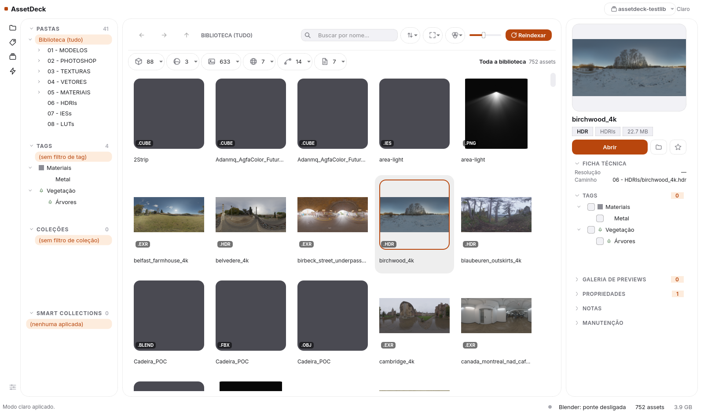 | 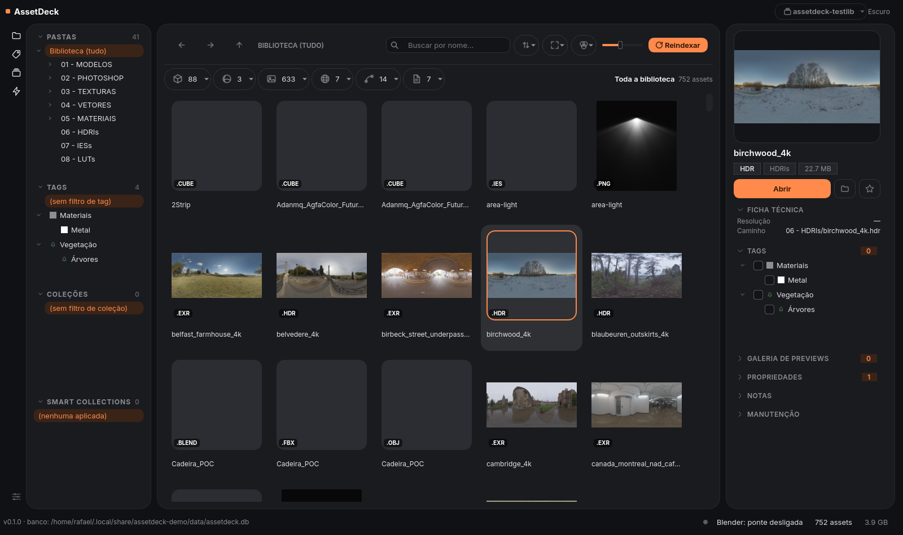 |
| *Grade de assets com navegação lateral, categorias, filtros e painel de detalhes preenchido inspecionando material PBR.* | *Tema escuro com alto contraste WCAG, miniaturas nítidas, tags hierárquicas e ficha técnica completa.* |

### Visualizadores 3D Integrados (OpenGL)

| Visualizador de HDRI / EXR | Visualizador de Modelos 3D |
|---|---|
| 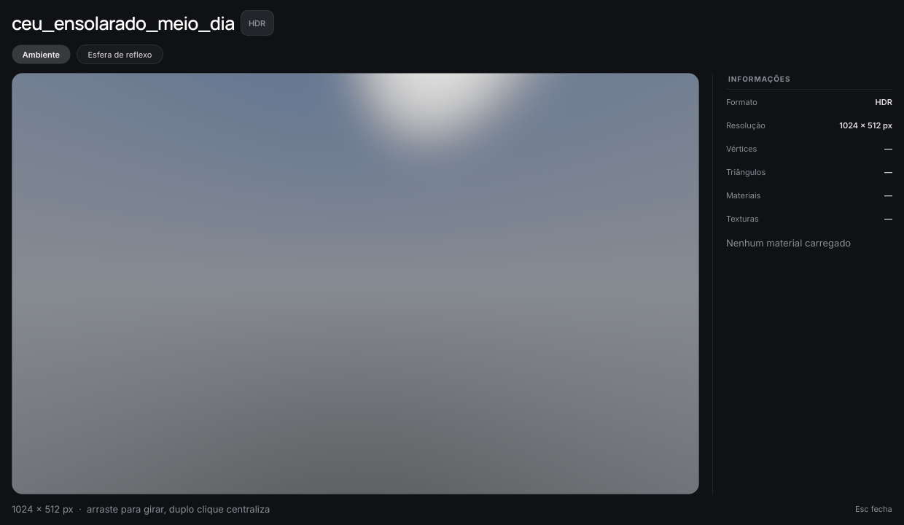 | 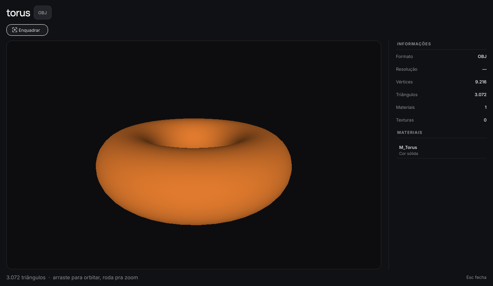 |
| *Projeção equirretangular 360°, rotação orbital, modo esfera de reflexo e leitura de alcance dinâmico.* | *Órbita 3D em tempo real com iluminação difusa, sombreamento suave de normais e leitura de materiais (.mtl).* |

### Organização e Busca Avançada

| Organização Lateral (Pastas, Tags e Coleções) | Busca Booleana com Operadores |
|---|---|
| 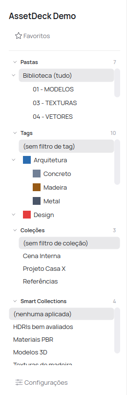 | 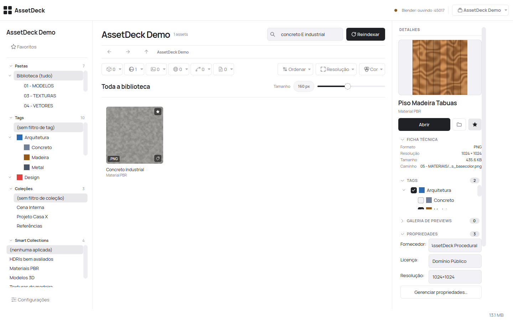 |
| *Árvore de pastas do disco, tags hierárquicas coloridas, coleções manuais e coleções inteligentes dinâmicas.* | *Busca combinada por nome e filtros avançados (`concreto E industrial`, `madeira OU metal`, `NÃO metal`).* |

### Central de Configurações (Modo Claro e Modo Escuro)

| Configurações no Modo Claro | Configurações no Modo Escuro |
|---|---|
| 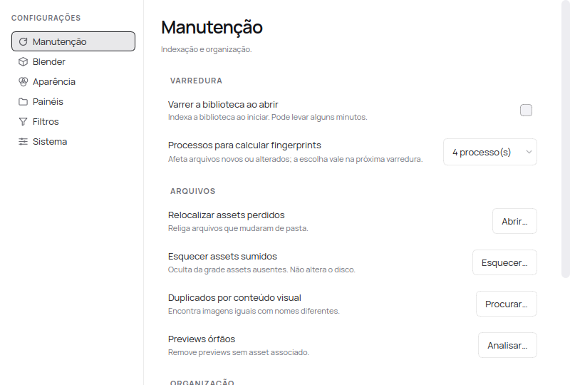 | 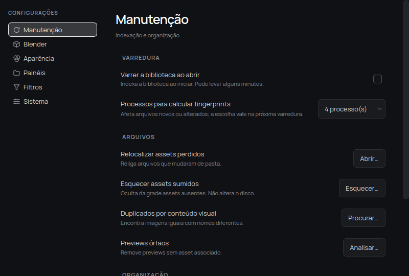 |
| *Manutenção do banco, biblioteca ativa, varredura ao abrir, processos paralelos e ponte do Blender.* | *Ajustes de sistema, manutenção e preferências adaptados com fidelidade ao tema escuro.* |

### Ferramentas e Primeira Execução

| Renomear em Lote | Detecção de Duplicatas | Primeira Execução (Estado Vazio) |
|---|---|---|
| 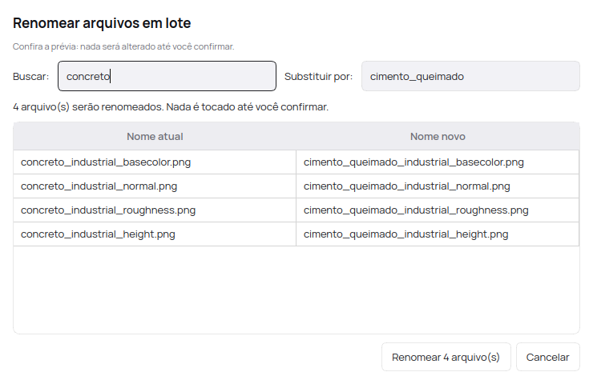 | 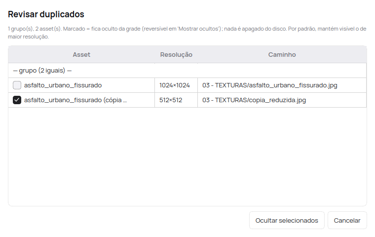 | 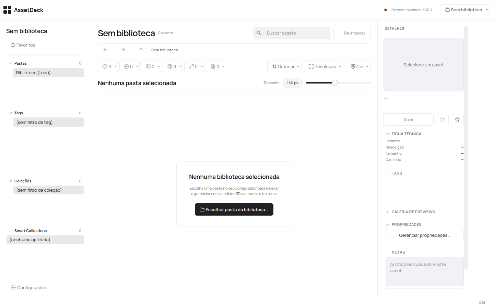 |
| *Substituição de texto em lote com prévia ao vivo de alterações e validação de conflitos.* | *Agrupamento de arquivos idênticos ou variantes redimensionadas por hash perceptual (pHash).* | *Tela inicial orientando a escolha da pasta da biblioteca.* |

---

## Recursos

- **Biblioteca somente-leitura por padrão:** O app analisa, calcula fingerprints e lê metadados sem tocar na sua pasta de assets. As únicas operações de escrita no disco (mover assets e renomear em lote) exigem confirmação explícita.
- **Agrupamento PBR automático:** Agrupa arquivos complementares (`_basecolor`, `_normal`, `_roughness`, `_height`, `_metallic`, `_ao`, etc.) em um único card de material PBR com capa representativa.
- **Associação automática de capas e previews:** Associa imagens de prévia homônimas (`Cadeira.blend` + `Cadeira.jpg`) ou pastas `previews/` e catálogos de packs ao respectivo modelo 3D.
- **Visualizador 3D em janela dedicada:**
  - **HDRIs e EXRs:** Projeção esférica equirretangular 360°, controle de rotação e zoom, visualização em modo esfera de reflexo para avaliar a iluminação e leitura precisa de resolução.
  - **Modelos 3D:** Órbita de câmera tridimensional para `.obj`, `.fbx` (via Assimp) e `.blend` (via Blender headless), com reenquadramento automático, contagem de vértices, triângulos e inspeção de materiais.
- **Geração de miniaturas offline:** Cache determinístico indexado pelo `content_hash` do arquivo original. Inclui tonemapping com compressão de alcance dinâmico (Reinhard global + curva gamma 2.2) para `.hdr` e `.exr`, e renderização vetorial nítida para `.svg`.
- **Busca avançada e filtros multifacetados:**
  - Sintaxe de busca com operadores booleanos (`concreto E rústico`, `pedra OU metal`, `NÃO tijolo`).
  - Filtro por tipo de asset (Textura, Material PBR, Modelo 3D, HDRI, IES, LUT, Vetor).
  - Filtro por extensão, avaliação por estrelas, favoritos e cor dominante da imagem.
- **Organização estruturada e flexível:**
  - **Tags hierárquicas:** Árvore de tags com cores e ícones customizáveis.
  - **Sinônimos e aliases bilíngues:** Associa termos em português e inglês (ex.: `Madeira` = `Wood`, `Concreto` = `Concrete`).
  - **Coleções manuais:** Agrupamentos arbitrários organizados em árvore sem duplicar arquivos no disco.
  - **Coleções inteligentes:** Consultas salvas que reavaliam os critérios dinamicamente sobre o banco de dados.
  - **Avaliação e notas:** Classificação de 1 a 5 estrelas, marcador de favoritos e campo de anotações livres.
  - **Propriedades personalizadas (EAV):** Criação de campos tipados adicionais (Texto, Número, Booleano, Data), como *Fornecedor*, *Resolução* ou *Licença*.
- **Detecção de duplicatas por conteúdo visual:** Algoritmo de hash perceptual (pHash) que encontra imagens idênticas mesmo quando salvas em resoluções ou formatos diferentes.
- **Segurança de metadados com sidecars:** Espelho em `.assetdeck.json` gravado ao lado de cada asset para preservar tags, notas e avaliações de forma independente do banco SQLite.
- **Integração nativa com o Blender:** Ponte local via socket com token de segurança que permite arrastar assets direto para a viewport 3D e acionar renderização headless de capas de modelos.

---

## Baixar

Executáveis pré-compilados para Windows, macOS e Linux estão disponíveis na página oficial de [Releases](https://github.com/zsabados3523/AssetDeck/releases).

> [!IMPORTANT]
> **Aviso sobre executáveis não assinados:** Como o AssetDeck é um projeto open-source mantido de forma independente, os binários de release não possuem certificados comerciais pagos:
> - **Windows:** O Windows SmartScreen pode exibir o alerta *"O Windows protegeu o seu computador"*. Clique em **Mais informações** e em seguida em **Executar assim mesmo**.
> - **macOS:** O Gatekeeper pode bloquear a abertura inicial. Clique com o **botão direito** no aplicativo e selecione **Abrir**, ou acesse **Ajustes do Sistema → Privacidade e Segurança** e clique em **Abrir mesmo assim**.
> - **Linux:** Baixe o arquivo `.tar.gz`, extraia o conteúdo, torne o binário executável com `chmod +x assetdeck` e execute `./assetdeck`.

---

## Instalação a partir do código-fonte

### Requisitos

- Python 3.12+
- [Blender](https://www.blender.org/) 4.x ou 5.x (opcional, para a ponte de arrastar assets e render headless de capas)

### Passo a passo

1. Clone o repositório e acesse o diretório:
   ```bash
   git clone https://github.com/zsabados3523/AssetDeck.git
   cd AssetDeck
   ```

2. Crie e ative um ambiente virtual isolado:
   ```bash
   python3 -m venv .venv
   source .venv/bin/activate
   # No Windows (PowerShell): .venv\Scripts\Activate.ps1
   ```

3. Instale as dependências:
   ```bash
   pip install -r requirements.txt
   ```

4. Execute o aplicativo:
   ```bash
   python -m assetdeck
   ```

5. (Opcional no Linux) Crie o atalho no menu de aplicativos do sistema:
   ```bash
   python install_desktop_entry.py
   ```

---

## Primeiros Passos

1. **Definir a pasta da biblioteca:**
   Ao abrir o app pela primeira vez, o AssetDeck exibirá o estado inicial sem biblioteca. Selecione a pasta onde seus assets 3D e texturas já estão organizados. Você também pode alterar ou repontar esse caminho a qualquer momento no arquivo `config.json` ou pelo menu de configurações.

2. **Indexar os arquivos:**
   O AssetDeck **não varre o disco sozinho ao abrir** por padrão, evitando lentidão desnecessária em bibliotecas grandes com dezenas de milhares de arquivos. Clique no botão **Reindexar** na barra de topo sempre que adicionar novos arquivos à pasta. Se desejar a varredura automática ao iniciar, ative a opção em *Configurações → Manutenção → Varrer a biblioteca ao abrir*.

3. **Instalar a ponte do Blender (opcional):**
   No AssetDeck, acesse *Configurações → Blender → Instalar / atualizar add-on...* para copiar a extensão diretamente para a pasta de add-ons do Blender. Em seguida, no Blender, acesse *Edit → Preferences → Add-ons*, ative o **AssetDeck Bridge** e use o painel na barra lateral (`N`) da viewport 3D para receber modelos, materiais e mundos arrastados.

---

## Onde ficam os dados por Sistema Operacional

O AssetDeck segue rigorosamente as convenções de diretórios de cada sistema operacional (implementado em `assetdeck/config.py`). As localizações padrão são:

| Sistema | Configurações (`config.json`) | Banco de dados, logs e backups | Cache de miniaturas |
|---|---|---|---|
| **Linux** | `~/.config/assetdeck/` | `~/.local/share/assetdeck/` | `~/.cache/assetdeck/` |
| **Windows** | `%APPDATA%\assetdeck\` | `%LOCALAPPDATA%\assetdeck\` | `%LOCALAPPDATA%\assetdeck\cache\` |
| **macOS** | `~/Library/Application Support/assetdeck/` | `~/Library/Application Support/assetdeck/` | `~/Library/Caches/assetdeck/` |

> [!TIP]
> Todos os caminhos podem ser sobrescritos por variáveis de ambiente, ideal para ambientes portáteis ou scripts de automação:
> - `ASSETDECK_CONFIG_DIR`: Diretório do `config.json`
> - `ASSETDECK_DATA_DIR`: Diretório do `assetdeck.db`, backups e logs
> - `ASSETDECK_CACHE_DIR`: Diretório do cache de miniaturas e malhas

---

## Tecnologias

- **Interface Gráfica:** PySide6 (Qt 6.11) com folha de estilos modular QSS e sistema de tokens de cor calibrados para conformidade com normas de contraste WCAG.
- **Banco de Dados Local:** SQLite 3 estruturado com modo WAL (Write-Ahead Logging) e sistema de migrations versionadas.
- **Gráficos e Shaders:** OpenGL 3.30 Core Profile (`QOpenGLWidget`) com shaders GLSL para visualização equirretangular de HDRIs e malhas 3D.
- **Processamento de Imagens e Dados:** Pillow (PIL), NumPy, OpenCV e biblioteca oficial OpenEXR.
- **Integração 3D:** Parser OBJ nativo, suporte a FBX via Assimp e scripts headless de automação para Blender.

---

## Como regenerar os screenshots da documentação

O repositório inclui ferramentas determinísticas para gerar uma biblioteca demo sintética (livre de direitos autorais) e capturar todas as imagens da interface sem depender de configurações do usuário:

```bash
# 1. Gerar a biblioteca demo sintética em pasta temporária isolada
python tools/make_demo_library.py "/tmp/claude-1000/shots/AssetDeck Demo"

# 2. Executar o script de captura determinística (gera as imagens em docs/screenshots/)
QT_QPA_PLATFORM=offscreen python tools/capture_screenshots.py
```

O script configura automaticamente um ambiente isolado em `/tmp`, indexa os arquivos sintéticos, popula metadados de demonstração (tags, coleções, avaliações, propriedades) e salva as capturas otimizadas em `docs/screenshots/`.

---

## Contribuir

Contribuições são muito bem-vindas! Consulte o guia em [CONTRIBUTING.pt-BR.md](CONTRIBUTING.pt-BR.md) ([English](CONTRIBUTING.md)) e nosso [Código de Conduta](CODE_OF_CONDUCT.pt-BR.md) para orientações sobre o fluxo de desenvolvimento, testes automatizados e diretrizes da comunidade.

Há diversas formas de colaborar com o projeto:

- **Testar em Windows e macOS reais:** Como o desenvolvimento principal ocorre em Linux, testes em hardware e instalações reais de Windows (10/11) e macOS (Apple Silicon e Intel) são essenciais para validar atalhos de teclado, renderização de fontes, caminhos de arquivo e estabilidade da interface gráfica. Se encontrar algum problema, reporte abrindo uma issue com trechos de log (`assetdeck.log` ou `quedas.txt`).
- **Corrigir bugs e implementar melhorias:** Confira as issues abertas no repositório, especialmente aquelas com os rótulos [`good first issue`](https://github.com/zsabados3523/AssetDeck/labels/good%20first%20issue) e [`help wanted`](https://github.com/zsabados3523/AssetDeck/labels/help%20wanted).
- **Traduções e localização da interface (i18n):** Atualmente, toda a interface gráfica do AssetDeck está em português (pt-BR) e não há infraestrutura de internacionalização implementada no código-fonte. Contribuições para introduzir um sistema de i18n (como `gettext` ou ferramentas de tradução do Qt/PySide) e traduzir o aplicativo para o inglês e outros idiomas são muito bem-vindas.
- **Empacotamento e distribuição:** Ajuda para estruturar assinaturas digitais e notarização no macOS (Apple Developer ID / Gatekeeper), geração de instaladores no Windows (Inno Setup / MSIX) e pacotes para distribuições Linux (AppImage, Flatpak).
- **Documentação e tutoriais:** Criação de guias passo a passo, tutoriais práticos de integração com o Blender e melhorias na documentação técnica e de arquitetura.
- **Novos formatos de asset:** Propostas e implementação de parsers para formatos adicionais de modelos 3D, materiais, texturas ou gráficos vetoriais.
- **Compartilhar experiências e ideias:** Participe das conversas, dê feedback ou tire dúvidas nas [Discussões do GitHub](https://github.com/zsabados3523/AssetDeck/discussions).

Para rodar a suíte de testes:
```bash
QT_QPA_PLATFORM=offscreen pytest -q
```

---

## Licença

Distribuído sob a licença MIT. Consulte o arquivo [LICENSE](LICENSE) para obter mais informações.
